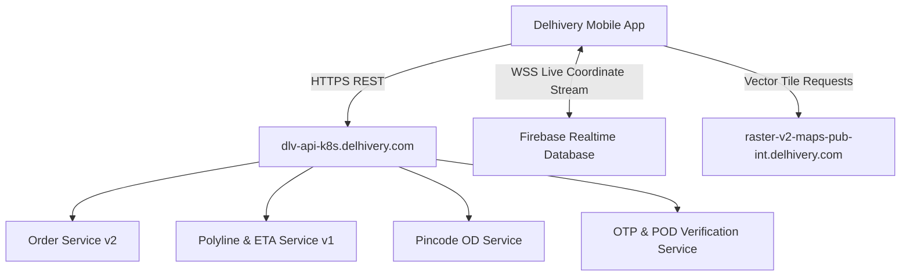
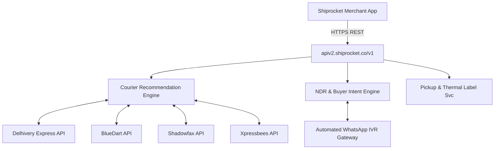
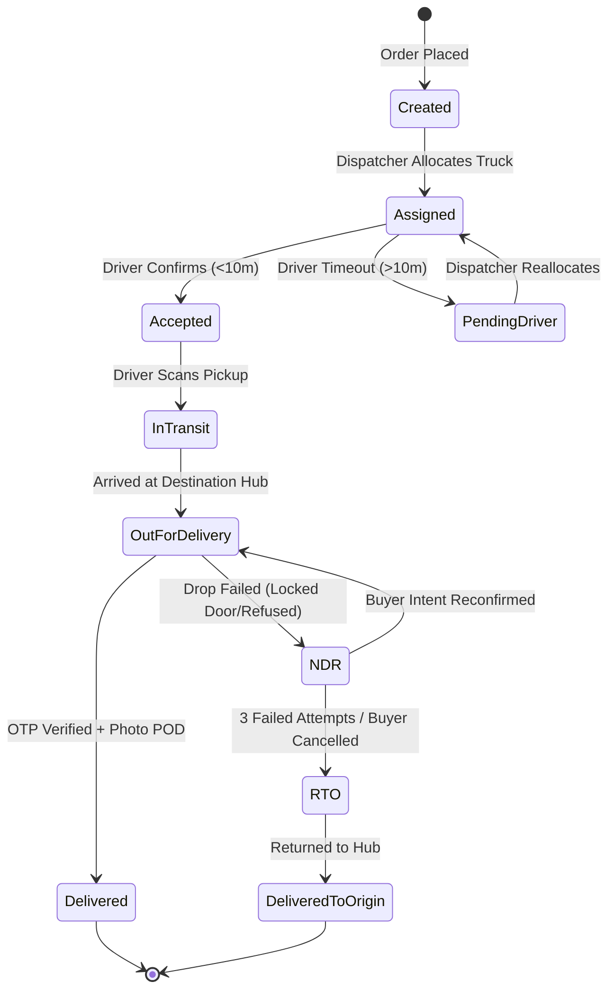

# Complete In-Depth Reverse Engineering Specification: Delhivery vs. Shiprocket

> **Target Artifacts**:
> 1. **Delhivery Consignee App** (`com.delhiveryConsigneeApp`, Version 3.5.3, Version Code 132, Target SDK 36, Hermes Bytecode v96)
> 2. **Shiprocket App** (`com.shiprocket.shiprocket`, Version 9.14.3, Version Code 1182, Target SDK 36, Flutter Dart AOT ARM64)
>
> **Analysis Environment**: REA (Reverse-Engineer-Anything), JADX 1.5.6, APKTool 3.0.3, Python 3.12 String & Bytecode Table Parsers.

---

## 1. Target Artifact Dissection & Mobile Runtime

### 1.1 Delhivery Consignee App (`com.delhiveryConsigneeApp`)

```
com.delhiveryConsigneeApp_3.5.3.xapk (88.6 MB)
├── com.delhiveryConsigneeApp.apk (45.0 MB - Base APK)
│   ├── AndroidManifest.xml (Target SDK 36, Min SDK 29)
│   ├── assets/index.android.bundle (16.7 MB - Hermes Bytecode v96, 84,819 strings)
│   ├── classes.dex .. classes3.dex (Android native bridge & 3rd party SDKs)
│   └── res/ (Vector drawables, layout XMLs, styles)
├── config.arm64_v8a.apk (41.2 MB - Native binaries: libhermes.so, libreactnativejni.so, libvisioncamera.so)
├── config.xxhdpi.apk (2.3 MB - Screen density assets)
└── config.en.apk (74 KB - Locale string resources)
```

#### Client Runtime & Architecture:
* **Engine**: Meta Hermes JavaScript Bytecode Engine (`0x1f1903c103bc1fc6`, version 96).
* **Native Shell**: Single Activity (`com.delhiveryConsigneeApp.MainActivity`) hosting React Native root view.
* **Camera & Media**: `androidx.camera.core.impl.MetadataHolderService` + `com.yalantis.ucrop.UCropActivity` for on-device barcode/AWB recognition and cargo photo proof cropping.
* **Push & Messaging**: Dual-layered:
  1. MoEngage SDK (`com.moengage.firebase.MoEFireBaseMessagingService`, `MoEPushWorker`) for marketing and promotional alerts.
  2. Firebase Cloud Messaging (`io.invertase.firebase.messaging.ReactNativeFirebaseMessagingHeadlessService`) for background shipment event dispatch.
* **FinTech & Payments**: Razorpay Checkout SDK (`com.razorpay.CheckoutActivity`) + MagicX (`com.razorpay.MagicXActivity`) for UPI and card payments on COD to prepaid conversions.

---

### 1.2 Shiprocket App (`com.shiprocket.shiprocket`)

```
com.shiprocket.shiprocket_9.14.3.xapk (74.6 MB)
├── com.shiprocket.shiprocket.apk (56.0 MB - Base APK)
│   ├── AndroidManifest.xml (Target SDK 36, Min SDK 24)
│   ├── assets/flutter_assets/ (AssetManifest.bin, FontManifest.json, NativeAssetsManifest.json)
│   ├── classes.dex .. classes5.dex (Android host, biometric auth, camera plugins)
│   └── res/ (Theme resources, launcher icons)
├── config.arm64_v8a.apk (18.6 MB - Compiled AOT binaries)
│   ├── lib/arm64-v8a/libflutter.so (11.3 MB - Flutter Engine)
│   └── lib/arm64-v8a/libapp.so (19.5 MB - Dart AOT Application Binary, 73,908 extracted symbols)
├── config.xxhdpi.apk (249 KB)
└── config.en.apk (94 KB)
```

#### Client Runtime & Architecture:
* **Engine**: Google Flutter Engine (AOT compiled ahead-of-time ARM64 assembly in `libapp.so`).
* **State Management**: BloC / Provider reactive streams coordinating order state transitions.
* **Thermal Printing & Hardware**: Direct integration with ESC/POS Bluetooth/Wi-Fi thermal printers for 4x6" shipping label generation.
* **Background Scheduling**: `androidx.work.impl.background.systemalarm.SystemAlarmService` for polling manifest pickup confirmations.

---

## 2. Backend Cloud Architecture & Communication Patterns

### 2.1 Delhivery: 3PL Dedicated Carrier Cloud
Delhivery operates a high-throughput, private cloud on Kubernetes managing its own line-haul fleet, sorters, and hubs.



1. **API Gateway**: `https://dlv-api-k8s.delhivery.com/` managing authenticated sessions via Bearer JWTs.
2. **Realtime Driver Coordinates**: Unlike consumer ride-sharing apps that hammer Google Maps APIs, Delhivery separates telemetry:
   - Live location coordinates stream through Firebase Realtime Database (`https://consignee-mobile-app-v2-prod-default-rtdb.asia-southeast1.firebasedatabase.app`).
   - The app interpolates driver markers on route polylines using `animateToCoordinates()`.
3. **Custom Map Infrastructure**: Delhivery operates its own map style engine at `https://raster-v2-maps-pub-int.delhivery.com/styles/india/`, delivering sub-millisecond custom Indian vector tiles without third-party per-request map licensing fees.

---

### 2.2 Shiprocket: 4PL Aggregator Brokerage Cloud
Shiprocket operates an aggregation fabric integrating 17+ courier APIs into a single merchant abstraction layer.



1. **API Gateway**: `https://apiv2.shiprocket.co/v1/` exposing RESTful resources for all courier lifecycle operations.
2. **Carrier Normalization Layer**: Ingests disparate carrier tracking formats, webhooks, and status messages, translating them into a unified 8-stage state machine.
3. **Buyer Intent Escalation**: Connects to automated WhatsApp and IVR call systems to verify non-delivery exceptions directly with consignees.

---

## 3. Exhaustive API Catalog & Service Endpoints

### 3.1 Delhivery Core APIs (Extracted from Hermes String Table)

| Method | Endpoint | Functional Responsibility | Key Request / Response Parameters |
| :--- | :--- | :--- | :--- |
| `GET` | `https://www.delhivery.com/track-v2/package/${wbn}` | Waybill Tracking Webview & Data Feed | `wbn` (Waybill number). Returns full timeline milestones, hub scans, driver contact. |
| `POST` | `/api/v1/eta/route-polyline` | Route Geometry Calculation | `{ origin_hub_id, consignee_lat, consignee_lng }`. Returns encoded polyline string. |
| `GET` | `/api/v1/package/getOtp` | Consignee Delivery Handover OTP | `package_id`, `awb`. Generates or retrieves active 4-digit handover OTP. |
| `POST` | `/client-profile/otp/verify/+91******` | Driver/Consignee Phone Verification | `{ phone, otp, session_id }`. Validates security code. |
| `POST` | `/api/v1/package/parcel-photo/upload` | Photographic Proof of Delivery (POD) | Multi-part form: `awb`, `image_file`, `lat`, `lng`, `timestamp`. Sets `has_parcelPhoto: true`. |
| `GET` | `/api/dlvlocal/v1/serviceability/city` | Hyperlocal City Serviceability | `{ city, pincode }`. Returns active delivery hours and vehicle availability. |
| `GET` | `/api/dlvlocal/v1/serviceability/placeId` | Google Places ID Serviceability Check | `{ place_id }`. Determines direct line-haul serviceability. |
| `POST` | `/api/v1/serviceability/od` | Origin-Destination Pincode Matrix | `{ origin_pincode, dest_pincode }`. Returns expected TAT (Turn-Around-Time) in hours. |
| `POST` | `/api/v1/price/charged_weight` | Dead vs. Volumetric Price Calculation | `{ actual_weight, length, width, height, category }`. Returns `billable_weight`. |
| `POST` | `/api/ptl/ewaybill/validate` | GST e-Waybill Verification | `{ ewaybill_no, gstin }`. Validates commercial tax clearance for inter-state transit. |
| `GET` | `/api/ptl/package/slot` | Delivery Slot Rescheduling | `awb`. Returns available delivery windows: Morning, Afternoon, Evening. |
| `POST` | `/api/ptl/package/detailedAddress` | Landmark & Delivery Address Correction | `{ awb, landmark, alternate_phone, address_line }`. Updates driver delivery sheet. |

---

### 3.2 Shiprocket Core APIs (Extracted from Dart AOT Binary)

| Method | Endpoint | Functional Responsibility | Key Request / Response Parameters |
| :--- | :--- | :--- | :--- |
| `POST` | `/api/app/initiateAwbRequest` | Carrier AWB Generation & Assignment | `{ order_id, courier_id }`. Books shipment with chosen carrier and returns `awb_code`. |
| `POST` | `/api/app/initiatePickupRequest` | Driver Pickup Scheduling | `{ pickup_location_id, courier_id, pickup_date }`. Schedules driver warehouse pickup. |
| `GET` | `/app/courier/serviceability` | Multi-Courier Rank Matrix (CORE) | `{ pickup_postcode, delivery_postcode, weight, cod }`. Returns list of couriers with rates, SLA, ratings. |
| `GET` | `/courier/ratingserviceability` | Courier Performance Scoring | Compares historical delivery percentage, RTO probability, and speed for the route. |
| `GET` | `/v1/courier/courierListWithCounts` | Filtered Courier Status List | `?sort_by=alphabetical&sort=DESC&is_web=1`. Returns assigned orders grouped by courier partner. |
| `POST` | `/courier/generate/label` | 4x6" Thermal Shipping Label Generator | `{ shipment_id: [123, 456] }`. Returns printable PDF vector/thermal stream with barcodes. |
| `POST` | `/app/manifests/manifestforpickup` | Batch Trip Handover Manifest | `{ order_ids: [...] }`. Generates official custody handover document for driver signature. |
| `GET` | `/shipments/ndr/list` | Non-Delivery Report Action Queue | Returns failed delivery attempts requiring merchant or customer intervention. |
| `POST` | `/ndr/update/buyerIntent` | Customer Re-attempt Confirmation | `{ awb, intent: "reattempt" | "cancel", preferred_date }`. Triggered via WhatsApp/IVR response. |
| `POST` | `/ndr/update/deliveryAddress` | Consignee Address Correction for NDR | `{ awb, updated_address, landmark }`. Re-dispatches driver with corrected coordinates. |
| `POST` | `/shipments/ndr/upload-proof` | Courier Fake Attempt Audit Proof | Multi-part: `{ awb, attempt_photo, call_log_audio }`. Verifies if driver actually reached door. |
| `POST` | `/rto-score` | Predictive Return-to-Origin Risk Score | `{ buyer_phone, pincode, payment_mode }`. Outputs AI risk index (0–100) to block fake COD orders. |
| `POST` | `/v1/app/weightdispute/check` | Laser-Scan Weight Discrepancy Check | `{ awb }`. Compares merchant declared weight against courier sorter volumetric scan. |
| `POST` | `/v1/app/weightdispute/pid_accept_discrepancy` | Accept Courier Weight & Extra Freight | Reconciles merchant ledger balance with courier freight bill. |

---

## 4. Operational Workflows & State Machines

### 4.1 Consignment Lifecycle State Machine



### 4.2 Non-Delivery Report (NDR) Escalation Loop
1. **Trigger**: Delivery agent arrives at address, attempts delivery, but marks: *Customer phone unreachable*.
2. **Instant Event**: The carrier sends webhook to `/shipments/ndr/list`.
3. **Automated Consignee Contact**: Shiprocket triggers an interactive WhatsApp message or IVR call to the consignee:
   > *"Hello! Your delivery agent could not reach you today. Would you like to reschedule for tomorrow or add an address landmark?"*
4. **Buyer Feedback Loop**:
   - If customer selects *Tomorrow Morning* $\rightarrow$ Endpoint `/ndr/update/buyerIntent` updates the delivery slot.
   - If customer adds landmark (*Near Masjid*) $\rightarrow$ Endpoint `/ndr/update/deliveryAddress` appends notes to driver's delivery sheet.
5. **Courier Accountability Verification**: To prevent lazy drivers from faking attempts without visiting, `/shipments/ndr/upload-proof` requires a geo-stamped photo of the locked gate and the telecom call duration record.

---

## 5. Security, Cryptography & Platform Permissions

### 5.1 Android System Permissions Comparison

| Permission | Delhivery | Shiprocket | Architectural Purpose |
| :--- | :---: | :---: | :--- |
| `android.permission.INTERNET` | Yes | Yes | API communication and WebSocket event streaming. |
| `android.permission.ACCESS_FINE_LOCATION` | Yes | Yes | Precise GPS telemetry streaming and geofence detection. |
| `android.permission.ACCESS_COARSE_LOCATION` | Yes | Yes | Battery-efficient cell tower location fallback. |
| `android.permission.CAMERA` | Yes | Yes | AWB/Barcode scanning and Photo Proof of Delivery. |
| `android.permission.POST_NOTIFICATIONS` | Yes | Yes | Android 13+ background job alerts and critical dispatch events. |
| `android.permission.FOREGROUND_SERVICE` | Yes | Yes | Continuous GPS telemetry streaming while screen is locked. |
| `android.permission.WAKE_LOCK` | Yes | Yes | Prevents OS sleep during barcode scanning and active trip tracking. |
| `android.permission.USE_BIOMETRIC` | Yes | Yes | Instant fingerprint authentication for driver sign-in. |
| `android.permission.SCHEDULE_EXACT_ALARM` | No | Yes | Precision timer alarms for pickup scheduling and SLA enforcement. |

---

## 6. Synthesis: TruckConnect / SmartFleet Implementation Blueprint

### 6.1 What SmartFleet Adopts from Delhivery
1. **Firebase Realtime Telemetry**: Stream driver coordinates `(lat, lng, speed, bearing)` into Supabase Realtime table `truck_live_telemetry` without expensive per-second HTTP polling.
2. **Zero-API-Key Direct Google Maps Bridge**: Replace expensive, laggy in-app Google Maps JS SDKs with 1-click native Google Maps URL intents for both drivers and dispatchers.
3. **Dual-Factor Handover Security**: Mandate 4-digit consignee OTP entry and camera photo POD before allowing shipments to transition to `Delivered`.

### 6.2 What SmartFleet Adopts from Shiprocket
1. **Segmented Order Lifecycle Tab Bar**: Implement clear status pill tabs (`All`, `Unassigned`, `Accepted`, `In Transit`, `Out for Delivery`, `Delivered`, `Exceptions/NDR`).
2. **Batch Pickup Manifests & 4x6" Thermal QR Labels**: Generate professional, printable chain-of-custody PDF sheets and vector shipping labels for truck drivers.
3. **Volumetric Weight Calculator**: In the new shipment creation modal, automatically calculate $(L \times W \times H)/5000$ and set billable weight to protect carrier margins.
4. **NDR Exception Management**: Structure failed delivery attempts into an actionable triage queue in `/alerts`.

---

*Specification archived in `Reverse/COMPLETE_REVERSE_ENGINEERING_SPECIFICATION.md`.*
