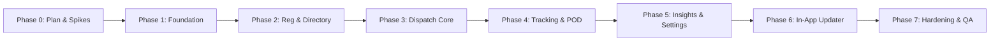

# TruckConnect — Comprehensive Build Plan

**Document Version:** 1.0  
**Status:** Approved for Phase 0 Execution  
**Project:** TruckConnect (Android Fleet Management Platform)  
**Target Region:** Kerala, India  
**Target Audience:** Commercial fleet owners, dispatchers, and elderly goods transport drivers (Malayalam-first)  

---

## 1. Executive Summary & Core Mission

TruckConnect replaces phone-call dispatch for Kerala-based lorry and truck transport fleets. The system connects business operations across two unified primary roles within a single Android application and a cloud backend:
- **Admin/Dispatcher:** Creates shipments, assigns available drivers and vehicles, tracks transport operations in real-time on an interactive map, and monitors automated milestones and digital delivery evidence.
- **Driver:** Operates a hyper-simplified, high-contrast, Malayalam-first mobile interface tailored for drivers aged 45–65 with minimal digital literacy. Receives instant loud job alerts on lock screens, executes trips via single-tap milestone buttons, navigates via installed GPS apps, and captures tamper-proof proof of delivery (POD).

### Non-Negotiable Engineering Principles
1. **Zero-Spend Free Tier Initial Validation:** Runs exclusively on vetted free tiers (Supabase Free, Hugging Face Space / Supabase Edge Functions, Firebase Cloud Messaging, OpenStreetMap vector tiles). All future enterprise upgrades are mapped into `docs/UPGRADE-PATH.md` with modular adapters.
2. **Native Android Stack:** Kotlin + Jetpack Compose with custom design tokens built over Material 3. Clean Architecture (MVVM, UDF, Hilt, Room, WorkManager, CameraX, MapLibre Native).
3. **Elderly Driver UX:** Minimum $56\text{ dp}$ buttons, body text $\ge 18\text{ sp}$, status encoded as color + icon + text, zero horizontal/infinite scrolling, maximum 3 taps to any operational action.
4. **Resilient Offline-First Sync:** Idempotent client request IDs (`client_request_id`) with local SQLite/Room action queues and background sync via WorkManager over flaky 2G/3G highway connectivity.
5. **Direct In-App Updater:** Autonomous version checking, checksum validation, and PackageInstaller session updates directly from cloud object storage without manual APK sharing.
6. **Agent-Assisted Verification:** Verification of every UI layout against the visual blueprint and execution of automated flows using the `moreplay` Android MCP server on an emulator.

---

## 2. Complete Screen Inventory

The visual source of truth is established in `docs/blueprint/` (`TruckConnect – Android App Blueprint.html`), extended with the driver self-registration and admin approval specifications.

```
Total Screens in Scope: 30 Screens
├── Start & Authentication (5 Screens)
├── Admin Portal (12 Screens)
├── Driver Experience (7 Screens)
└── Shared & System (6 Screens)
```

### 2.1 Start & Authentication Flow (5 Screens)
1. **SCR-AUTH-01: Splash Screen**
   * Dark indigo canvas (`#0E1330`), glowing turquoise brand icon, app title, version tag, and tagline *"Every load. Every mile."*
   * Automated session check and token decryption from Android Keystore.
2. **SCR-AUTH-02: Role Selection Screen**
   * Two primary large cards: **Admin** (*Manage the fleet*) and **Driver** (*Run your trips*).
   * Bottom bar with language switch (മലയാളം / English) and version number.
3. **SCR-AUTH-03: Driver Login Screen**
   * Indian mobile number input (`+91`), 4-digit PIN input fields.
   * "Get OTP / Login with PIN" primary button.
   * Action button: *"New driver? Register here / പുതിയ ഡ്രൈവർ? രജിസ്റ്റർ ചെയ്യുക"*.
4. **SCR-AUTH-04: Driver Self-Registration Screen (New)**
   * Multi-step structured card layout:
     * Step 1: Personal Details (Full Name in English/Malayalam, Mobile number).
     * Step 2: 4-digit Security PIN setup (self-selected, confirmed).
     * Step 3: Emergency Contact (Name, Relationship, Phone number).
     * Step 4: Driving Licence (DL number, DL class: HMV / LMV-Trans, Expiry date).
     * Step 5: Document Capture (CameraX capture of DL front and back).
     * Step 6: Fleet association (Company fleet vs Owner-operator) & DPDP Act location tracking consent checkbox.
   * "Submit for Verification" action button.
5. **SCR-AUTH-05: Driver Registration Status Screen (New)**
   * Pending verification notification card (`ഡ്രൈവർ പരിശോധനയിലാണ്`).
   * Explains that Admin approval is required before trips can be received.
   * Tap-to-call Admin support button and refresh status trigger.
6. **SCR-AUTH-06: Admin Login Screen**
   * Work email and password input fields.
   * "Sign in" primary button, "Forgot password?" link, optional 2-factor authentication code prompt.

### 2.2 Admin Experience (12 Screens)
1. **SCR-ADM-01: Fleet Dashboard**
   * Metric chips: On Trip (active count), Available (free drivers/trucks), Pending (unassigned jobs), Delayed (late trips).
   * Active Live Trips list cards with route (`Kochi → Kozhikode`), assigned driver, vehicle reg, and current milestone tag.
   * Bottom navigation bar (Home, Map, Jobs, Drivers, More).
2. **SCR-ADM-02: Live Fleet Map**
   * Full-screen vector map powered by MapLibre Native with custom OpenStreetMap styling.
   * Custom vehicle markers indicating live movement speed and status color (Green = On trip, Blue = Available, Gray = Offline).
   * Expandable bottom sheet showing vehicle details, driver name, current speed, and destination.
3. **SCR-ADM-03: New Shipment Creation**
   * Pickup address and contact person phone number.
   * Drop address and consignee contact phone number.
   * Goods description, weight (tonnes), scheduled pickup time, expected delivery time.
   * "Continue to Assignment" primary button.
4. **SCR-ADM-04: Driver & Vehicle Assignment Sheet**
   * List of available drivers with proximity and vehicle pairing.
   * Warning banner if driver is on trip or vehicle is over capacity.
   * "Assign Shipment" instant trigger.
5. **SCR-ADM-05: Shipment Directory (Jobs List)**
   * Filter tabs: All, Active, Pending, Completed, Cancelled.
   * Search by shipment ID (e.g., `TC-2026-000123`), driver name, or destination town.
6. **SCR-ADM-06: Shipment Detail & Timeline**
   * Complete milestone progression timeline with exact timestamps, geo-coordinates, and actor IDs.
   * Reassign and Cancel actions (with required audit reasons).
   * Route overview map snippet and attached e-way bill / documents.
7. **SCR-ADM-07: Proof of Delivery (POD) Viewer**
   * High-resolution display of captured delivery photos, consignee signature, and receiver name.
   * One-tap export to PDF / share via WhatsApp.
8. **SCR-ADM-08: Driver Directory**
   * Filterable list: Available, On Trip, Offline, Inactive.
   * Driver card showing photo, rating, current vehicle, and today's status.
9. **SCR-ADM-09: Driver Detail Profile**
   * Lifetime trips, on-time delivery rate, licence expiry warning, emergency contact details, assigned truck.
   * Actions: Reassign truck, Reset PIN, Deactivate / Revoke device.
10. **SCR-ADM-10: Pending Driver Approvals (New)**
    * Dedicated queue for drivers who self-registered.
    * Side-by-side inspection of submitted licence details, phone number, and DL front/back photos.
    * "Approve Driver" (Green) and "Reject with Reason" (Red) buttons.
11. **SCR-ADM-11: Vehicle Management & Compliance**
    * List of fleet vehicles with registration number, capacity, and current driver.
    * Document compliance cards: RC, Insurance, Fitness, Permit, PUC with remaining validity in days.
12. **SCR-ADM-12: Reports & Analytics**
    * Aggregated fleet performance: Trips per driver/vehicle, on-time percentage, completed vs cancelled.
    * Date range filters and one-tap export to CSV/Excel and formatted PDF.

### 2.3 Driver Experience (7 Screens)
1. **SCR-DRV-01: Driver Home**
   * Dynamic header: "Hello, Ravi / നമസ്കാരം രവി", Duty status toggle ("On Duty / Off Duty").
   * Primary Card State:
     * When idle: Large minimalist card *"No job right now / ഇപ്പോൾ പുതിയ ലോഡുകൾ ഇല്ല. New jobs appear here."*
     * When assigned: Prominent card showing assigned route, cargo, and "View Job" trigger.
   * Bottom Navigation: Home, History, Profile.
2. **SCR-DRV-02: Full-Screen Job Alert (Lock Screen)**
   * High-priority alert triggered over lock screen with loud distinctive ringtone and vibration.
   * Clear, large route header: `Kochi → Kozhikode`.
   * Essential trip summary: `8 t · Rice · Today 4 PM`.
   * Huge touch targets: Green **Accept** ($\ge 56\text{ dp}$) and Red **Reject** ($\ge 56\text{ dp}$).
   * Rejection sheet: Single-tap predefined reasons (Vehicle breakdown, Sick, Distance too far).
3. **SCR-DRV-03: Active Trip & Milestone Progression**
   * Massive progressive milestone buttons with current active state highlight:
     1. `Reached Pickup / പിക്കപ്പ് എത്തി`
     2. `Loaded / ലോഡ് കയറ്റി`
     3. `In Transit / യാത്ര തുടങ്ങി`
     4. `Reached Drop / ഡെലിവറി എത്തി`
   * Persistent utility bar:
     * Single-tap **Navigate** (fires Geo Intent to Vela / OsmAnd / Google Maps).
     * Single-tap **Call Admin** and **Call Consignee**.
4. **SCR-DRV-04: Proof of Delivery (POD) Screen**
   * In-app CameraX view with guidance box to photograph goods / signed LR receipt.
   * Receiver name text input (with optional Malayalam voice input support).
   * Optional digital signature pad.
   * Large "Complete Delivery / ഡെലിവറി പൂർത്തിയാക്കുക" action button.
5. **SCR-DRV-05: Trip History**
   * Clean scrollable list of completed trips grouped by month.
   * Shows date, route, vehicle registration, and delivery status badge.
6. **SCR-DRV-06: Emergency SOS Alert**
   * Single-press SOS button that immediately dispatches emergency alert with precise GPS coordinates to the Admin dashboard and triggers automated phone call to emergency contacts.
7. **SCR-DRV-07: Driver Profile & Vehicle Info**
   * Shows driver name, masked phone number (`+91 98•••• 4210`), photo, licence validity status, and currently assigned vehicle registration.

### 2.4 Shared & System Screens (6 Screens)
1. **SCR-SYS-01: Settings Main**
   * Profile, Theme selection, Language switcher, Notification preferences, Security (Biometric/PIN lock), Help & Support, App Version.
2. **SCR-SYS-02: Theme Selector**
   * Four user-selectable themes: **Indigo** (default corporate), **Emerald** (clean green), **Graphite** (minimal monochrome), **Sunset** (high-contrast warm).
   * Modes: Light, Dark, System Auto.
   * Instant live preview meeting WCAG AA contrast standards.
3. **SCR-SYS-03: Language Switcher**
   * Clean toggle between **മലയാളം (Malayalam)** and **English**. Persisted locally in DataStore and synced with backend profile.
4. **SCR-SYS-04: Notification Center**
   * Chronological list of system notifications (Job assignments, status changes, document reminders, updates).
5. **SCR-SYS-05: Permission & Battery Guidance Screens**
   * Dedicated explainer screens before requesting runtime permissions: Location (Foreground + Background), Camera, Notifications.
   * OEM-specific guides for disabling aggressive background battery killing on Xiaomi (MIUI), Oppo/Realme (ColorOS), Vivo (Funtouch), and Samsung (OneUI).
6. **SCR-SYS-06: In-App Update Prompt (Flexible & Forced Gate)**
   * Flexible card: Short release notes in Malayalam & English with "Update Now" and download progress bar.
   * Forced update gate: Full-screen blocking modal if installed version is lower than `min_supported_version`.

---

## 3. Monorepo Module Architecture

```
truckconnect/
├── android/
│   ├── app/                    # Application entrypoint, Hilt DI root, Flavors (direct, play)
│   ├── core-design/            # Design tokens, typography (Plus Jakarta Sans + Malayalam), components
│   ├── core-network/           # Retrofit, OkHttp, Auth interceptors, Cert pinning, WebSocket
│   ├── core-data/              # Room DB, DataStore, Repositories, Offline sync WorkManager
│   ├── feature-auth/           # Login, Self-Registration, PIN setup, Auth navigation
│   ├── feature-admin/          # Dashboard, Live Map, Shipments, Drivers, Approvals, Reports
│   ├── feature-driver/         # Driver Home, Lock-screen Alert, Active Trip, Milestones, POD, SOS
│   └── feature-settings/       # Themes, Language, Profile, Device Settings, Update Check
├── backend/
│   ├── src/
│   │   ├── modules/
│   │   │   ├── auth/           # Driver/Admin JWT, PIN hashing, Device binding, Self-registration
│   │   │   ├── directory/      # Driver, Vehicle, Document management, Approvals
│   │   │   ├── shipments/      # Shipment lifecycle state machine, Assignment, Events
│   │   │   ├── tracking/       # Location ingestion, PostGIS queries, Stale ping detection
│   │   │   ├── notifications/  # FCM high-priority dispatcher, pg-boss escalation queue
│   │   │   ├── reporting/      # Aggregations, CSV/PDF export generation
│   │   │   ├── releases/       # In-app update version registry, APK metadata
│   │   │   └── audit/          # Immutable action logs
│   │   ├── common/             # Interceptors, Filters, Idempotency guards, Guards (RBAC)
│   │   └── main.ts
│   ├── Dockerfile
│   └── package.json
├── supabase/
│   ├── migrations/             # Versioned SQL migrations (PostGIS, Tables, RLS, Functions)
│   └── seed/                   # Dev test seed data (Kerala geography, test fleet)
├── e2e/mobile/                 # moreplay automation test flows (.yaml)
└── docs/                       # Specifications, blueprints, runbooks, architecture decisions
```

---

## 4. Technical Data Model & Schemas

### 4.1 PostgreSQL Schema with PostGIS & RLS
```sql
-- Extensions
CREATE EXTENSION IF NOT EXISTS "uuid-ossp";
CREATE EXTENSION IF NOT EXISTS "postgis";

-- Enums
CREATE TYPE user_role AS ENUM ('super_admin', 'dispatcher', 'driver');
CREATE TYPE user_status AS ENUM ('pending_verification', 'active', 'inactive', 'suspended');
CREATE TYPE driver_availability AS ENUM ('available', 'on_trip', 'on_leave', 'offline');
CREATE TYPE vehicle_status AS ENUM ('available', 'on_trip', 'maintenance');
CREATE TYPE shipment_status AS ENUM (
  'created', 'assigned', 'accepted', 'rejected', 
  'reached_pickup', 'loaded', 'in_transit', 'reached_drop', 
  'delivered', 'cancelled', 'failed'
);
CREATE TYPE approval_status AS ENUM ('pending', 'approved', 'rejected');
CREATE TYPE document_kind AS ENUM (
  'driving_licence_front', 'driving_licence_back', 'aadhaar_card', 
  'rc_book', 'insurance_policy', 'fitness_certificate', 'permit', 'puc'
);

-- Users Table
CREATE TABLE users (
  id UUID PRIMARY KEY DEFAULT uuid_generate_v4(),
  role user_role NOT NULL,
  name VARCHAR(255) NOT NULL,
  phone VARCHAR(20) UNIQUE NOT NULL,
  email VARCHAR(255) UNIQUE,
  password_hash VARCHAR(255),
  pin_hash VARCHAR(255),
  pin_failed_attempts INT DEFAULT 0,
  pin_locked_until TIMESTAMPTZ,
  status user_status NOT NULL DEFAULT 'active',
  language VARCHAR(10) DEFAULT 'ml',
  theme VARCHAR(20) DEFAULT 'indigo',
  created_at TIMESTAMPTZ DEFAULT NOW(),
  updated_at TIMESTAMPTZ DEFAULT NOW()
);

-- Drivers Table
CREATE TABLE drivers (
  user_id UUID PRIMARY KEY REFERENCES users(id) ON DELETE CASCADE,
  licence_no VARCHAR(50) NOT NULL,
  licence_type VARCHAR(50) NOT NULL,
  licence_expiry DATE NOT NULL,
  emergency_contact_name VARCHAR(255) NOT NULL,
  emergency_contact_phone VARCHAR(20) NOT NULL,
  emergency_contact_relation VARCHAR(50) NOT NULL,
  vehicle_ownership VARCHAR(50) DEFAULT 'company_fleet',
  preferred_vehicle_id UUID,
  approval_status approval_status DEFAULT 'approved',
  rejection_reason TEXT,
  approved_by UUID REFERENCES users(id),
  approved_at TIMESTAMPTZ,
  availability driver_availability DEFAULT 'offline',
  current_location GEOMETRY(Point, 4326),
  last_location_at TIMESTAMPTZ,
  created_at TIMESTAMPTZ DEFAULT NOW(),
  updated_at TIMESTAMPTZ DEFAULT NOW()
);

-- Vehicles Table
CREATE TABLE vehicles (
  id UUID PRIMARY KEY DEFAULT uuid_generate_v4(),
  reg_no VARCHAR(20) UNIQUE NOT NULL,
  type VARCHAR(50) NOT NULL,
  capacity_kg INT NOT NULL,
  status vehicle_status DEFAULT 'available',
  default_driver_id UUID REFERENCES users(id),
  created_at TIMESTAMPTZ DEFAULT NOW(),
  updated_at TIMESTAMPTZ DEFAULT NOW()
);

-- Shipments Table
CREATE TABLE shipments (
  id UUID PRIMARY KEY DEFAULT uuid_generate_v4(),
  code VARCHAR(50) UNIQUE NOT NULL,
  status shipment_status NOT NULL DEFAULT 'created',
  pickup_address TEXT NOT NULL,
  pickup_geo GEOMETRY(Point, 4326),
  pickup_contact_name VARCHAR(255),
  pickup_contact_phone VARCHAR(20),
  drop_address TEXT NOT NULL,
  drop_geo GEOMETRY(Point, 4326),
  drop_contact_name VARCHAR(255),
  drop_contact_phone VARCHAR(20),
  goods_description TEXT NOT NULL,
  weight_kg INT NOT NULL,
  scheduled_at TIMESTAMPTZ NOT NULL,
  expected_at TIMESTAMPTZ,
  driver_id UUID REFERENCES users(id),
  vehicle_id UUID REFERENCES vehicles(id),
  created_by UUID REFERENCES users(id) NOT NULL,
  created_at TIMESTAMPTZ DEFAULT NOW(),
  updated_at TIMESTAMPTZ DEFAULT NOW()
);

-- Shipment Events (Audit Log of Status Transitions)
CREATE TABLE shipment_events (
  id UUID PRIMARY KEY DEFAULT uuid_generate_v4(),
  shipment_id UUID REFERENCES shipments(id) ON DELETE CASCADE,
  status shipment_status NOT NULL,
  actor_id UUID REFERENCES users(id) NOT NULL,
  geo_point GEOMETRY(Point, 4326),
  note TEXT,
  client_request_id VARCHAR(64) UNIQUE,
  created_at TIMESTAMPTZ DEFAULT NOW()
);

-- Location Pings (Partitioned by Month)
CREATE TABLE location_pings (
  id BIGSERIAL,
  driver_id UUID NOT NULL REFERENCES users(id),
  shipment_id UUID REFERENCES shipments(id),
  geo_point GEOMETRY(Point, 4326) NOT NULL,
  speed_kmh FLOAT,
  accuracy_meters FLOAT,
  battery_pct INT,
  recorded_at TIMESTAMPTZ NOT NULL,
  created_at TIMESTAMPTZ DEFAULT NOW(),
  PRIMARY KEY (id, recorded_at)
) PARTITION BY RANGE (recorded_at);

-- Proof of Delivery
CREATE TABLE proofs_of_delivery (
  id UUID PRIMARY KEY DEFAULT uuid_generate_v4(),
  shipment_id UUID UNIQUE REFERENCES shipments(id) ON DELETE CASCADE,
  photo_urls TEXT[] NOT NULL,
  receiver_name VARCHAR(255) NOT NULL,
  signature_url TEXT,
  otp_verified BOOLEAN DEFAULT FALSE,
  created_at TIMESTAMPTZ DEFAULT NOW()
);

-- App Releases (In-App Updater Registry)
CREATE TABLE app_releases (
  id UUID PRIMARY KEY DEFAULT uuid_generate_v4(),
  flavor VARCHAR(20) NOT NULL,
  version_code INT NOT NULL,
  version_name VARCHAR(50) NOT NULL,
  min_supported_version_code INT NOT NULL,
  apk_url TEXT NOT NULL,
  sha256_checksum VARCHAR(64) NOT NULL,
  file_size_bytes BIGINT NOT NULL,
  release_notes_en TEXT,
  release_notes_ml TEXT,
  rollout_percentage INT DEFAULT 100,
  created_at TIMESTAMPTZ DEFAULT NOW()
);
```

---

## 5. Phase-by-Phase Roadmap & Exit Criteria



### Phase 0: Plan & Architectural Spikes
* **Scope:** BUILD-PLAN.md, validation spikes (Hugging Face Docker Space, Supabase PostGIS, MapLibre & Kerala vector tiles, FCM full-screen alert).
* **Exit Criteria:** `docs/DECISIONS.md` drafted, spikes analyzed and approved.

### Phase 1: Foundation & Auth
* **Scope:** Monorepo setup, core-design token system with 4 themes, Navigation shell, NestJS skeleton, Supabase v1 migrations, Admin & Driver phone/PIN login, Keystore token persistence.
* **Exit Criteria:** End-to-end login operational on emulator for both roles, CI passing.

### Phase 2: Registration & Directory
* **Scope:** Driver self-registration workflow, DL photo upload, Admin pending approvals queue, vehicle directory, document compliance.
* **Exit Criteria:** New driver self-registers, Admin approves, driver logs in successfully.

### Phase 3: Dispatch Core
* **Scope:** Shipment creation, vehicle assignment, FCM high-priority dispatch, lock-screen job alert, accept/reject state transitions, escalation timers.
* **Exit Criteria:** Admin assigns job, driver alert fires within 5 seconds on emulator, admin dashboard updates via Realtime.

### Phase 4: Trip Execution & Tracking
* **Scope:** Milestone progression, foreground tracking service, location ping batching, offline queue via Room, MapLibre live fleet map, CameraX proof of delivery.
* **Exit Criteria:** Complete trip executed with network disconnection mid-trip and clean sync upon reconnection.

### Phase 5: Admin Insights & Customization
* **Scope:** Reports, alerts center, PDF/Excel export, full theme switcher (Indigo, Emerald, Graphite, Sunset), Malayalam/English locale switching.
* **Exit Criteria:** All 30 screens fully implemented and visually verified against blueprint.

### Phase 6: In-App Updater & Releases
* **Scope:** In-app updater engine (PackageInstaller API), checksum verification, release registry API, GitHub Actions release pipeline.
* **Exit Criteria:** New APK download and seamless installation verified on test device/emulator.

### Phase 7: Hardening, Security & Pilot Verification
* **Scope:** DPDP Act compliance review, RLS security audit, performance tuning (<2s cold start on 2GB RAM profile), runbook finalization.
* **Exit Criteria:** Full `moreplay` regression test suite passes; zero open high/critical issues.

---

## 6. Risk Analysis & Mitigation Matrix

| Risk | Impact | Probability | Mitigation Strategy |
| :--- | :--- | :--- | :--- |
| **Elderly Driver Cognitive Load** | Critical | High | One primary action per screen; Malayalam-first copy; minimum $56\text{ dp}$ buttons; voice readouts; audio alerts; no text typing where pickers exist. |
| **OEM Background App Murder (MIUI, ColorOS)** | High | High | Foreground service with persistent notification; battery optimization white-list explainer screen on first launch; stale ping detection flags. |
| **Highway Network Dropouts (Kerala Ghats)** | High | High | Offline-first architecture; Room SQLite queue; idempotent write operations via `client_request_id`; automated WorkManager retries. |
| **Supabase Free Inactivity Pausing** | High | Medium | Scheduled GitHub Actions keep-alive workflow executing every 3 days. |
| **Hugging Face Docker Space Free Restrictions** | Medium | Medium | Evaluated fallbacks in Phase 0 (Supabase Edge Functions or free container host). |
| **Public Map Rate Limits** | Medium | Medium | OpenFreeMap / Protomaps vector tiles; client-side route caching; external Geo Intent for navigation. |

---

## 7. Open Questions & Assumptions

1. **Target Android Fleet Profiles:** Assumes Android 8.0+ (API 26+) with active GPS and mobile data.
2. **DLT SMS Registration:** Free tier uses self-chosen PIN; paid SMS OTP deferred to upgrade phase.
3. **Hardware GPS Integration:** Non-goal for v1; mobile device GPS used exclusively.
